<div align="center">

# 🏥 HospiLink

**One platform for the whole hospital floor: patients, beds, vitals, appointments, pharmacy, billing and ambulance dispatch.**

[**Live demo**](https://hospi-link-two.vercel.app/) · [Screenshots](#a-quick-tour) · [Run it locally](#run-it-locally) · [How it is built](#how-it-is-built)

[](https://github.com/Ayaalmadhon2004/HospiLink/actions/workflows/ci-cd.yml)


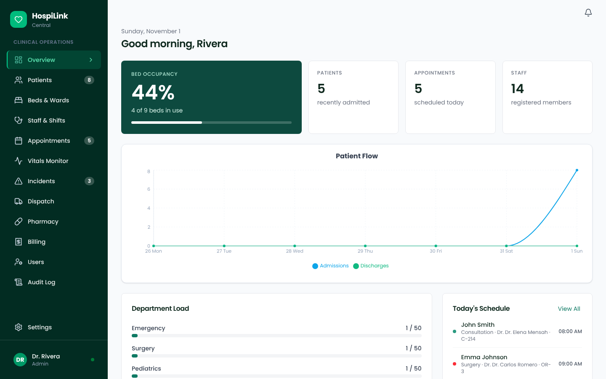

</div>

---

## Why I built it

Hospital software is where small bugs turn into real problems: a bed that shows as free while a patient is in it, a medicine dispensed twice, an invoice number that skips, one hospital seeing another hospital's patients.

HospiLink is my attempt to build the everyday tools of a hospital **and** to get those hard parts right. Most of the interesting work is not in the screens, it is in the rules underneath them, and every one of those rules is enforced by the database or a transaction and then proven by a test against a real PostgreSQL.

It is a portfolio project, not a certified medical product. Do not use it with real patient data.

## A quick tour

| | |
|---|---|
| 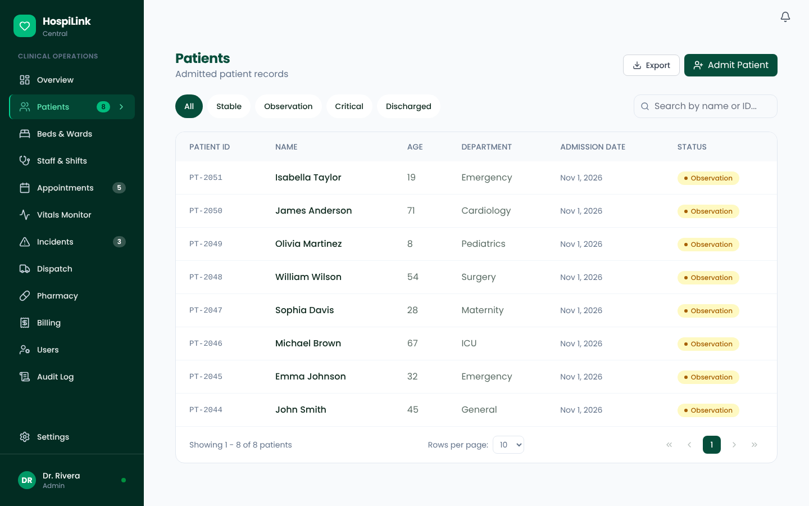 **Patients.** Admit, search, filter by status, discharge, export. Patient codes (`PT-2051`) are generated safely under a database lock. | 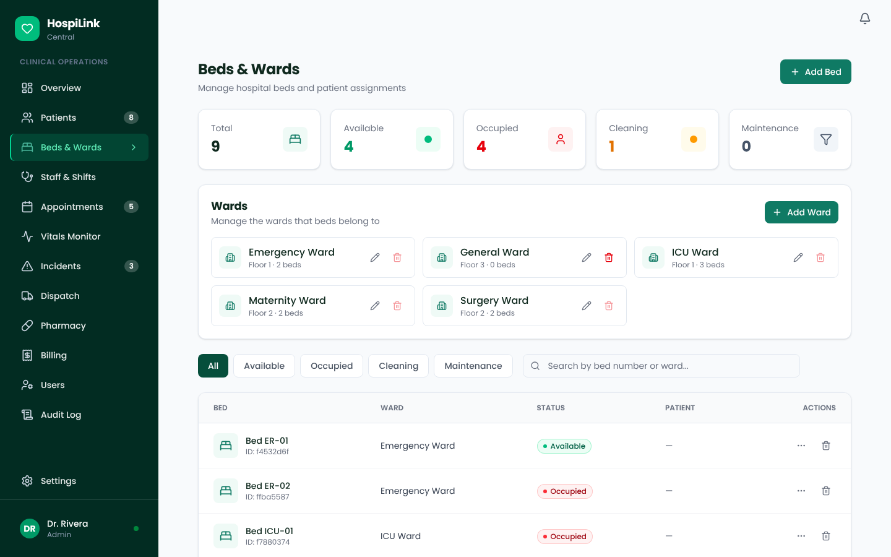 **Beds and wards.** A bed is occupied if and only if a patient is in it. Wards are managed by admins. |
| 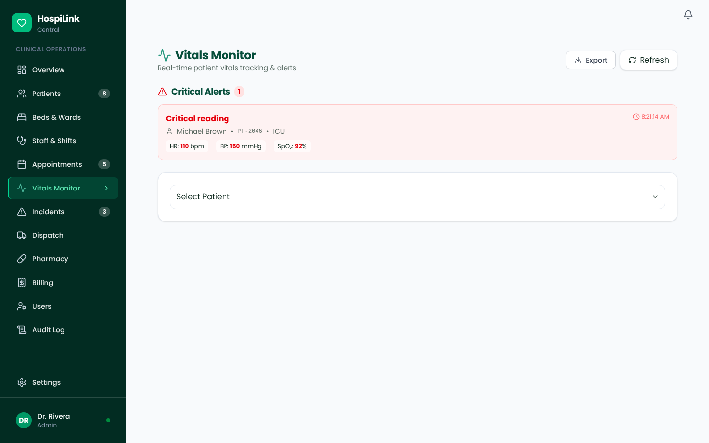 **Vitals monitor.** Readings arrive from the UI or from bedside devices (HL7, FHIR, JSON). A critical reading escalates the patient and alerts the team in real time. | 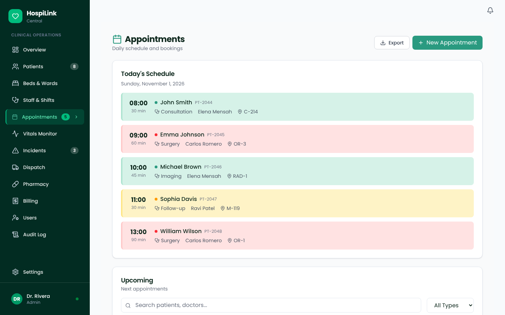 **Appointments.** A doctor can never be double-booked, even by two people clicking at the same second. |
| 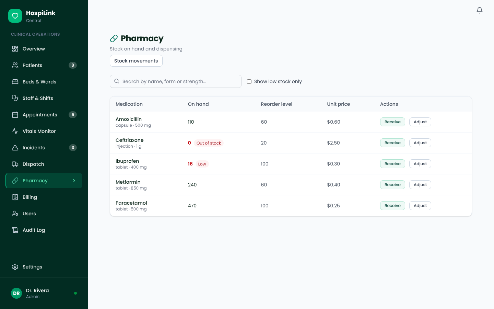 **Pharmacy.** Live stock, low-stock and out-of-stock flags, receive and adjust with a full ledger. | 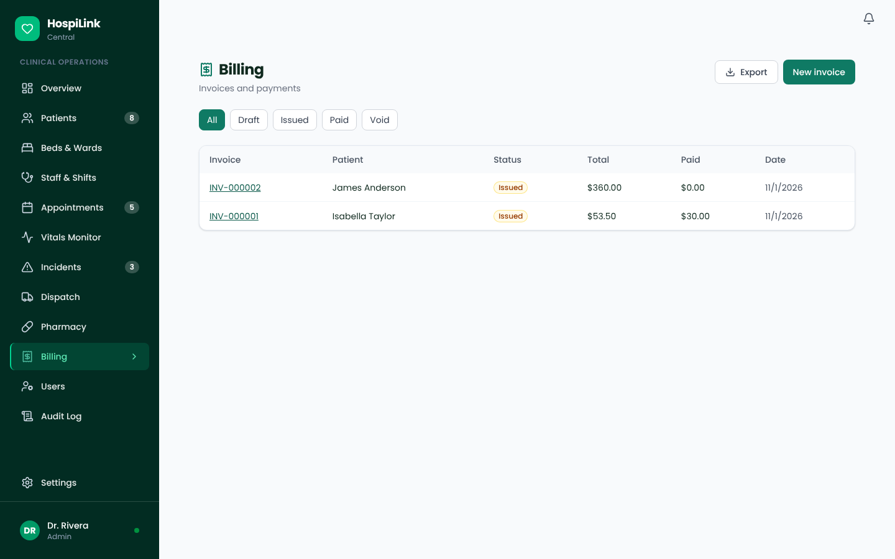 **Billing.** Draft, issued, paid or void invoices with gap-free numbers and money kept as integers. |
| 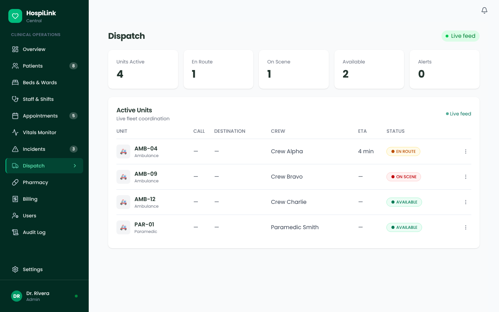 **Ambulance dispatch.** Units, live status, calls and assignment, shared in real time with the dispatchers. | 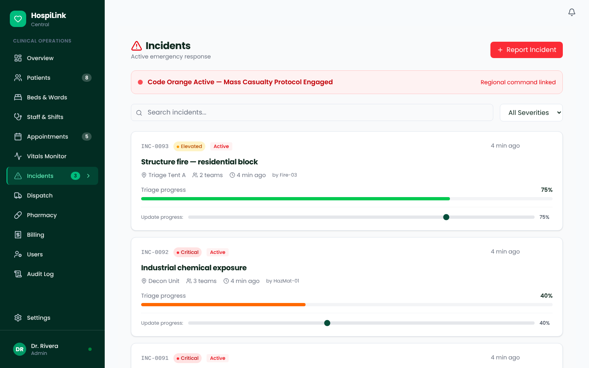 **Incidents.** Report, triage by severity, follow through to resolved. |
| 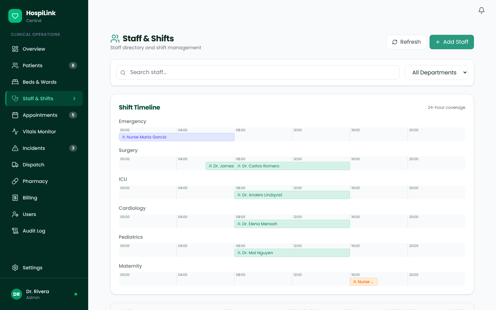 **Staff and shifts.** Directory, shift timeline, and an optional link between a staff member and their login. | 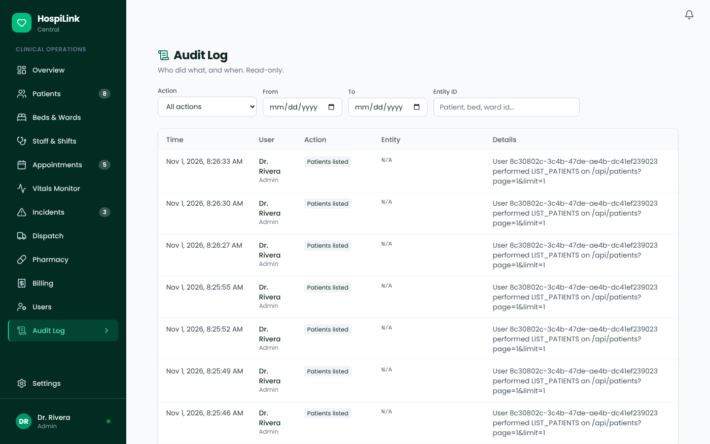 **Audit log.** Every change by every user is recorded and visible to admins only. |

<details>
<summary><b>More screens: prescriptions and an invoice</b></summary>
<br>

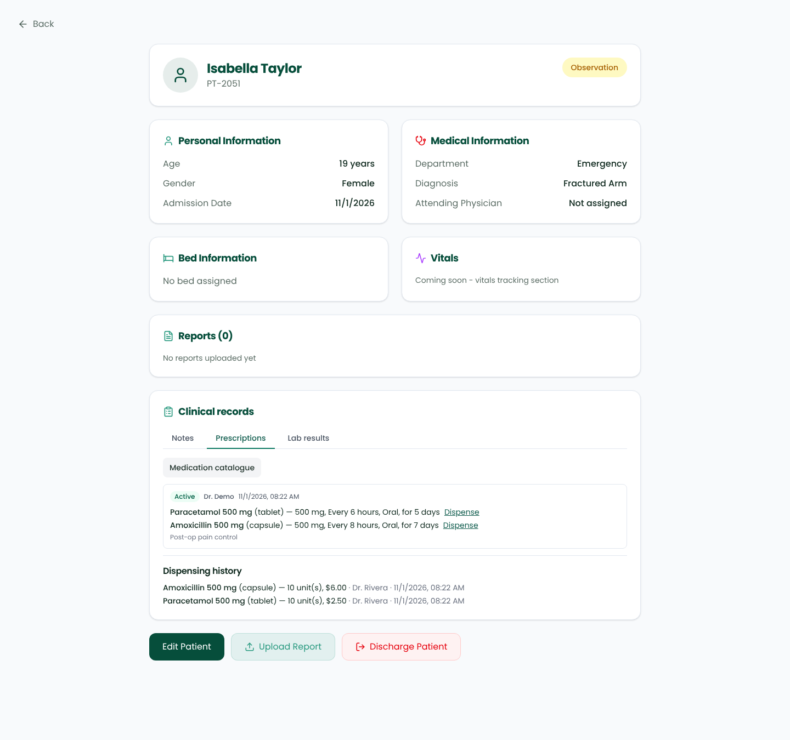

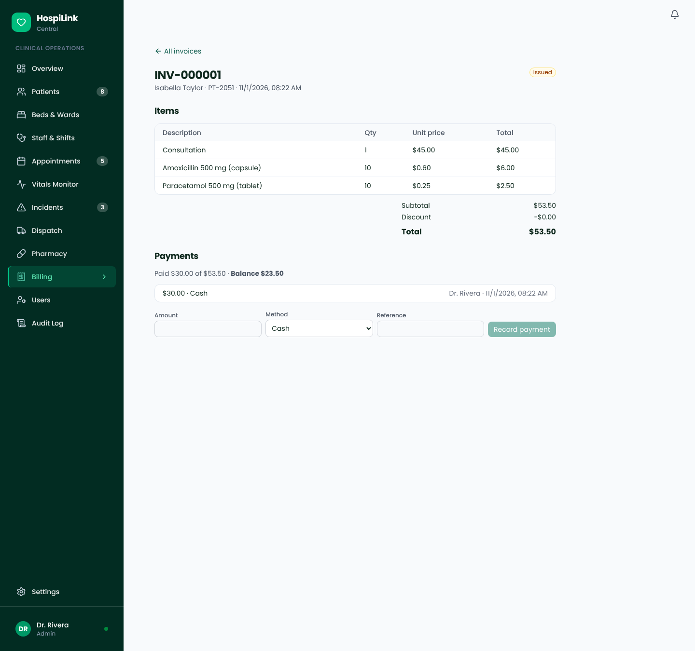

</details>

## What it does

**Clinical care**
- **Patients and beds.** Admission, discharge, soft delete (a patient is never really erased), bed assignment that can never get out of sync with the patient.
- **Vitals.** Heart rate, blood pressure, SpO₂, temperature and more, with thresholds per hospital and department. Critical readings flag the patient and notify the department over Socket.io.
- **Clinical records.** Append-only clinical notes (an amendment is a new version, the history is never overwritten), prescriptions, lab orders and results with automatic abnormal and critical flags.
- **Appointments.** Conflict detection per doctor, reminders sent by an external scheduler.

**Operations**
- **Pharmacy.** A medication catalogue per hospital, stock that can never go below zero, dispensing straight from an active prescription, and a ledger of every movement.
- **Billing.** Invoices built from dispensed medicines and manual lines, discounts, partial payments, void, and Excel or PDF export.
- **Ambulance dispatch.** Units, crews, calls, assignment and live location.
- **Incidents, staff and shifts, notifications.**

**Platform**
- **Roles.** Admin, Doctor, Nurse, Dispatcher, checked on the server for every request and mirrored in the UI.
- **Security.** Account approval, password reset, email verification, two-factor authentication (TOTP) with recovery codes, token revocation on logout.
- **Arabic and English**, with full right-to-left layout.
- **Installable PWA**, and every export (Excel, PDF) is hospital-scoped and audit-logged.

## How it is built

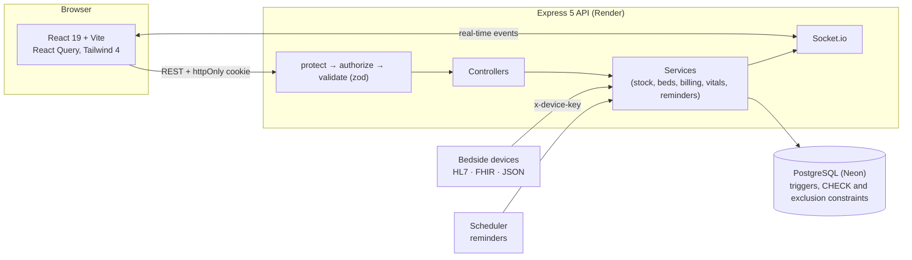

The path of every request is the same: **route → middleware → controller → Prisma**. Business rules that must never be bypassed live in small services, and the strictest ones live in the database itself.

### The decisions I am proudest of

These are the parts that took thought, and the reason there is a test for each one.

| Problem | How HospiLink solves it |
|---|---|
| **Two nurses claim the same bed** | `claimBed` is one atomic `UPDATE ... WHERE status = AVAILABLE`. Exactly one wins, the other gets a clean 409. |
| **Stock goes negative or is dispensed twice** | Stock changes only through `changeStock`: one conditional `UPDATE` ("enough on hand" is in the `WHERE`) plus a ledger row in the same transaction, with a database `CHECK` as a second wall. |
| **Invoice numbers skip** | The number is taken from a per-hospital counter in the same transaction as the status change, so a refused issue burns no number. Money is integer minor units, never floats. |
| **One hospital sees another's data** | Every query is scoped by the hospital of the logged-in user, loaded from the database, never read from the request. A test walks every id-taking route to prove it. |
| **Double-booked doctors** | An overlap check in code plus a PostgreSQL **exclusion constraint**, so even a race between two requests is rejected. |
| **A patient record "deleted" by mistake** | Patients are soft-deleted and a database trigger refuses a real `DELETE`. Clinical notes are append-only with a trigger too. |
| **A stolen token after logout** | Every token has a `jti`, logout stores it in a revocation list, and role changes or password changes invalidate old sessions. |
| **Reminders sent twice by two server instances** | Each reminder is claimed with an `INSERT ... ON CONFLICT DO NOTHING` before it is sent. |

## Tech stack

| Layer | Tools |
|---|---|
| **Frontend** | React 19, Vite 8, TypeScript (strict), Tailwind CSS 4, TanStack Query 5, React Router 7, Recharts, i18next (EN/AR + RTL), Socket.io client |
| **Backend** | Node.js, Express 5, TypeScript, Prisma 7 with `@prisma/adapter-pg`, Socket.io, zod 4, JWT + bcrypt, otplib (2FA), exceljs and pdfkit (exports), Sentry (optional) |
| **Database** | PostgreSQL on Neon, with migrations, triggers, CHECK and exclusion constraints |
| **Quality** | Jest, Vitest, Testing Library, Playwright, k6, ESLint with `no-explicit-any`, GitHub Actions, OWASP ZAP and gitleaks workflows |
| **Hosting** | Vercel (frontend), Render (API), Neon (database), Docker Compose for the full stack locally |

## Roles at a glance

| | Admin | Doctor | Nurse | Dispatcher |
|---|:-:|:-:|:-:|:-:|
| Patients, beds, vitals, appointments | ✅ | ✅ | ✅ | read patients |
| Clinical notes | read | write all | nursing notes | – |
| Prescriptions and lab orders | read | write | read, enter results | – |
| Dispense medicine | ✅ | ✅ | ✅ | – |
| Receive and adjust stock | ✅ | – | – | – |
| Billing and invoices | ✅ | – | – | – |
| Dispatch | ✅ | – | – | ✅ |
| Users, staff, wards, audit log | ✅ | – | – | – |

Roles are read from the database on every request, never trusted from the token.

## Run it locally

You need **Node 20+** and a **PostgreSQL** database (local, Docker, or a free [Neon](https://neon.tech) project).

**1. Backend**

```bash
cd backend
npm install
cp .env.example .env     # fill in DATABASE_URL, JWT_SECRET, CORS_ORIGINS
npx prisma generate
npx prisma migrate deploy
npx prisma db seed       # demo hospital, patients, staff, beds, medications
npm run dev              # http://localhost:5000
```

**2. Frontend**

```bash
cd frontend
npm install
cp .env.example .env     # VITE_API_URL=http://localhost:5000/api
npm run dev              # http://localhost:5173
```

Set `CORS_ORIGINS=http://localhost:5173` in the backend `.env`. After seeding, sign in with the seeded demo admin `dr.rivera@curesync.com` / `Password123!` (local demo data only, change it for anything real).

**Prefer Docker?** `docker compose --env-file .env.docker up --build`, see [docs/DOCKER.md](docs/DOCKER.md).

<details>
<summary><b>Environment variables</b></summary>
<br>

| Variable | Where | Needed | Purpose |
|---|---|:-:|---|
| `DATABASE_URL` | backend | yes | PostgreSQL connection string |
| `JWT_SECRET` | backend | yes | Long random string, the API will not boot without it |
| `CORS_ORIGINS` | backend | yes | Comma-separated frontend origins (CORS and Socket.io) |
| `VITE_API_URL` | frontend | yes | API base including `/api` |
| `TWO_FACTOR_ENC_KEY` | backend | for 2FA | 32 random bytes, base64 |
| `APP_URL`, `SMTP_URL`, `MAIL_FROM` | backend | for emails | Password reset and verification links |
| `COOKIE_DOMAIN` | backend | optional | Shared parent domain, switches the cookie to `SameSite=Lax` |
| `REMINDERS_CRON_SECRET` | backend | optional | Enables the reminders endpoint |
| `SENTRY_DSN` | backend | optional | Error reporting, no personal data sent |

Everything else is documented in [`backend/.env.example`](backend/.env.example).

</details>

## Testing

HospiLink is tested in layers, because mocks cannot prove what a database enforces.

| Layer | What it proves | Command |
|---|---|---|
| **Backend unit** (875 tests) | Controllers, validators, middleware, with Prisma and sockets mocked | `cd backend && npm test` |
| **Backend integration** | Triggers, constraints, row-lock races, tenant isolation, device ingestion and socket rooms on a **real PostgreSQL** | `npm run test:int` |
| **Frontend unit** (396 tests) | Components, hooks, permissions | `cd frontend && npm test` |
| **E2E, mocked API** | Login, route guards, main flows in a real browser | `npm run test:e2e` |
| **E2E, real backend** | Whole journeys per role, from prescription to invoice and Excel/PDF download | `npm run test:e2e:real` |
| **Load tests** (k6) | Contention, rate limits, exports | see [docs/LOAD_TESTS.md](docs/LOAD_TESTS.md) |

CI runs lint, build and every suite above on each push.

## Project structure

```
HospiLink/
├── backend/
│   ├── prisma/            schema, migrations, seed
│   ├── src/
│   │   ├── routes/        one file per resource
│   │   ├── controllers/   request handlers
│   │   ├── services/      stock, beds, billing, vitals, reminders...
│   │   ├── middlewares/   auth, audit, validation, errors
│   │   └── validators/    zod schemas
│   ├── tests/             unit tests (Prisma mocked)
│   └── tests-int/         integration tests (real PostgreSQL)
├── frontend/
│   ├── src/
│   │   ├── pages/         one page per route
│   │   ├── components/    UI, generic form engine
│   │   ├── hooks/         React Query CRUD, sockets
│   │   └── i18n/          English and Arabic
│   ├── e2e/               Playwright, mocked API
│   └── e2e-real/          Playwright, real backend
├── docs/                  design notes (vitals, exports, migrations, security...)
└── perf/                  k6 load scripts
```

## Documentation

Full index: [docs/README.md](docs/README.md).

[Vitals integration](docs/VITALS_INTEGRATION.md) · [Exports](docs/EXPORTS.md) · [Notifications and reminders](docs/NOTIFICATIONS.md) · [Migrations](docs/MIGRATIONS.md) · [Integration tests](docs/INTEGRATION_TESTS.md) · [Real E2E](docs/E2E_REAL.md) · [Load tests](docs/LOAD_TESTS.md) · [Backups and retention](docs/BACKUP_AND_RETENTION.md) · [Security scanning](docs/SECURITY_SCANNING.md) · [i18n](docs/I18N.md) · [PWA](docs/PWA.md) · [Roadmap](docs/ROADMAP.md)

## Deployment

- **Frontend** on Vercel: root `frontend`, build `npm run build`, output `dist`, env `VITE_API_URL`.
- **API** on Render: root `backend`, build `npm install && npx prisma generate && npm run build`, start `npm start`. Apply migrations with `npx prisma migrate deploy`.
- **Database** on Neon, with short connection timeouts so a sleeping database fails fast instead of hanging requests.
- A small GitHub Actions workflow pings `/api/health` so the free Render tier stays awake.

## Known limits and what is next

Honest list of what is not there yet: no allergy or drug-interaction checks, no tax, refunds or insurance claims in billing, no dedicated pharmacist or billing role, and PDF exports do not render Arabic text yet. See [docs/ROADMAP.md](docs/ROADMAP.md).

## Contributing

Issues and pull requests are welcome. Read [CONTRIBUTING.md](CONTRIBUTING.md) first, and report vulnerabilities privately as described in [SECURITY.md](SECURITY.md). Everything is covered by the [Code of Conduct](CODE_OF_CONDUCT.md).

## Author

Built by **Aya Almadhon**. [GitHub](https://github.com/Ayaalmadhon2004) · [Portfolio](https://portfolio-of-aya.vercel.app)

## License

[MIT](LICENSE)
