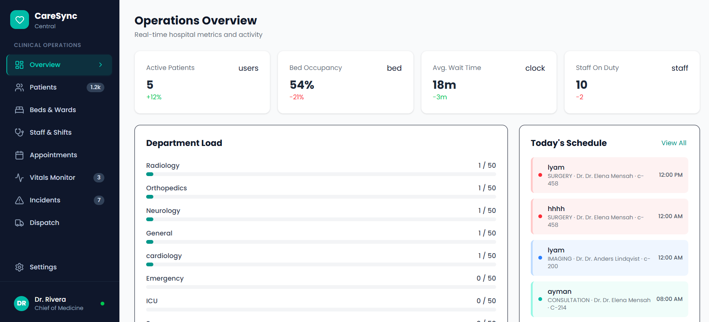
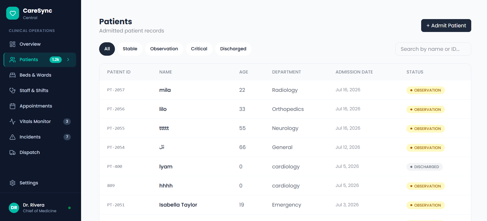
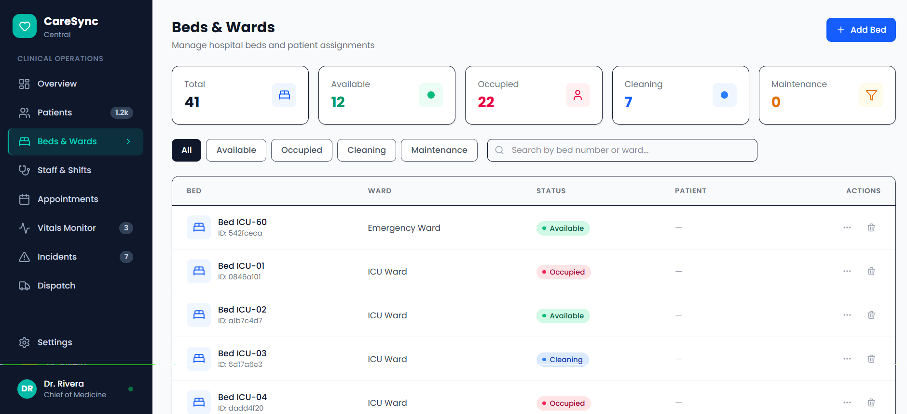

# HospiLink

**Hospital management platform for patient flow, bed and ward capacity, vitals monitoring, appointments, incidents, staff scheduling and ambulance dispatch.**

**Live demo:** [hospi-link-liart.vercel.app](https://hospi-link-liart.vercel.app/)





---

## Table of contents

1. [Features](#features)
2. [Roadmap / planned](#roadmap--planned)
3. [Tech stack](#tech-stack)
4. [Project structure](#project-structure)
5. [Getting started](#getting-started)
6. [Roles and permissions](#roles-and-permissions)
7. [API overview](#api-overview)
8. [Real-time events](#real-time-events)
9. [Testing](#testing)
10. [Deployment](#deployment)
11. [Security notes](#security-notes)
12. [Contributing](#contributing)

---

## Features

Everything below exists in the code today.

| Area | What it does |
|------|--------------|
| Authentication | Signup, login, logout, current user, password change. JWT in an httpOnly cookie (or `Authorization: Bearer`). Public signup always creates the lowest-privilege role (`NURSE`). |
| Patients | Admit, list with filters and pagination, view, edit, discharge, recent patients, available beds. Report upload (jpeg, png, pdf, max 5 MB). |
| Beds and wards | Ward list, bed CRUD and status updates, occupancy shown on the dashboard. |
| Vitals monitoring | Record, list, update and delete vitals per patient, configurable thresholds, critical alerts, live charts. |
| Appointments | CRUD, today's schedule, upcoming appointments. |
| Incidents | Report, update, change status, delete, list active incidents. |
| Staff and shifts | Staff directory (admin-managed), shift CRUD and a 24 hour shift timeline. |
| Ambulance dispatch | Units and live status, create calls, assign a unit to a call, unit location updates. |
| Notifications | Per-user notifications with read, read-all and delete; bell in the UI. |
| Settings | Per-user profile, notification, security and display settings. |
| Dashboard | Stat cards, department bars and patient-flow chart (recharts). |
| Audit log | Most mutating routes are wrapped in `logActivity(...)` and stored in `AuditLog`. |
| Real-time | Authenticated Socket.io for vitals, appointments, incidents, shifts and dispatch. |

## Roadmap / planned

These were listed in earlier versions of this README. Except for the partial i18n item, they are **not implemented**. Verified against the code: there is no web manifest or service worker, no `web-vitals` package, and no Dockerfile or docker-compose file in the repository.

- Translate the remaining pages. Arabic / English (RTL) is in place for the shell, Login, Sidebar and Dashboard; see `docs/I18N.md`.
- Progressive Web App support (manifest, service worker, offline mode).
- Web Vitals / performance monitoring.
- Docker images and docker-compose for the full stack.
- Fine-grained RBAC (per-permission policies, a reception role). Today access is a fixed set of four roles checked per route.
- Deeper EHR: diagnoses, medications, visit history and clinical notes. Today a patient has basic demographics, status, bed, vitals and uploaded reports.
- Automated patient queue management.
- Logistics and resource-utilisation reporting.
- Frontend component and E2E tests, and a logger instead of the remaining `console.*` calls in the frontend.
- Move legacy file-based report uploads (`/uploads/...`, on Render's ephemeral disk) off disk. New reports are stored in the database (`Report.fileData`).

## Tech stack

### Backend
| Technology | Purpose |
|------------|---------|
| Node.js, Express 5 | REST API |
| TypeScript | Type safety |
| Prisma 7 (`@prisma/adapter-pg`) | ORM |
| PostgreSQL (Neon) | Database |
| Socket.io 4 | Real-time events |
| zod 4 | Request validation |
| jsonwebtoken, bcryptjs | Auth and password hashing |
| helmet, express-rate-limit, cors, compression, cookie-parser | HTTP hardening and performance |
| multer | File uploads |
| jest, ts-jest, supertest, jest-mock-extended | Testing |

### Frontend
| Technology | Purpose |
|------------|---------|
| React 19 + react-router-dom 7 | UI and routing (pages lazy-loaded) |
| Vite 8 + TypeScript | Build tooling |
| Tailwind CSS 4 | Styling |
| TanStack React Query 5 | Server state, optimistic CRUD |
| axios | HTTP client |
| socket.io-client | Real-time |
| recharts | Charts |
| sonner, lucide-react | Toasts and icons |

## Project structure

```
HospiLink/
├── backend/
│   ├── prisma/
│   │   ├── schema.prisma        # Data model
│   │   └── seed.ts              # Demo data
│   ├── src/
│   │   ├── config/              # db.ts (Prisma client), jwt.ts
│   │   ├── controllers/         # Request handlers (Prisma calls)
│   │   ├── middlewares/         # auth, audit, error, upload, socket.auth, dispatch.socket
│   │   ├── routes/              # One file per resource
│   │   ├── types/               # Shared types
│   │   ├── validators/          # zod schemas
│   │   └── server.ts            # App bootstrap, Socket.io, route mounting
│   ├── tests/                   # jest tests and mocks
│   ├── uploads/                 # Runtime uploads (git-ignored)
│   ├── prisma.config.ts
│   └── jest.config.js
├── frontend/
│   ├── public/
│   ├── src/
│   │   ├── components/          # UI components (Form/ = generic modal forms)
│   │   ├── configs/             # entityConfigs.ts (declarative forms)
│   │   ├── constants/
│   │   ├── contexts/            # AuthContext
│   │   ├── hooks/               # useCrud, use*Socket, useSettings ...
│   │   ├── pages/               # One page per route
│   │   ├── services/            # axios API layer
│   │   ├── types/
│   │   └── App.tsx              # Routes
│   ├── vercel.json              # SPA rewrite
│   └── vite.config.ts
├── docs/
│   ├── images/                  # README screenshots
│   └── vitals/DATA_FLOW.md
├── .github/workflows/ci-cd.yml  # CI/CD pipeline
└── CLAUDE.md                    # Contributor guidelines
```

## Getting started

### Prerequisites
- Node.js 20+ and npm
- A PostgreSQL database (local, or a free [Neon](https://neon.tech) project)

### Backend

```bash
cd backend
npm install
cp .env.example .env        # then fill in real values
npx prisma generate
npx prisma db push          # create tables from schema.prisma
npx prisma db seed          # optional demo data (runs tsx prisma/seed.ts, see prisma.config.ts)
npm run dev                 # http://localhost:5000
```

`prisma/migrations` contains a baseline migration and `report_file_data`. For a new empty database use `npx prisma migrate deploy` (or `migrate dev` in development); `db push` also works. An existing production database created with `db push` must first be marked with `migrate resolve --applied` (see `docs/MIGRATIONS.md`).

Environment variables (`backend/.env`, never commit it):

| Variable | Required | Description |
|----------|----------|-------------|
| `DATABASE_URL` | yes | PostgreSQL connection string |
| `JWT_SECRET` | yes | Long random string. The server refuses to start without it. |
| `PORT` | no | Defaults to `5000` |
| `HOSPITAL_ID` | no | Hospital that public signups join. Defaults to the first hospital in the database. |
| `NODE_ENV` | no | `production` disables dev logging |

Backend scripts: `npm run dev` (tsx watch), `npm run build` (tsc to `dist/`), `npm start` (run `dist/server.js`), `npm test`, `npm run test:watch`, `npm run test:coverage`.

### Frontend

```bash
cd frontend
npm install
npm run dev                 # http://localhost:5173
```

Set `VITE_API_URL` (for example `http://localhost:5000`) in `frontend/.env` to point at a local API; otherwise it falls back to the hosted Render API. Scripts: `npm run dev`, `npm run build` (`tsc -b && vite build`), `npm run lint`, `npm run preview`.

The backend CORS allowlist (`allowedOrigins` in `backend/src/server.ts`) must include every frontend origin you use.

## Roles and permissions

Roles come from the database (`protect` reloads the user on every request) and are checked per route with `authorize(...)`.

| Role | Can do |
|------|--------|
| `ADMIN` | Everything. Exclusive rights: create/update/delete staff, delete beds, delete shifts, delete vitals. |
| `DOCTOR` | Admit, view, edit and discharge patients; record and update vitals; create, update and delete appointments; create and update beds; create, update and delete incidents; create and update shifts; create dispatch calls. |
| `NURSE` | Admit, view and edit patients (no discharge); record and update vitals; create and update appointments; report incidents. Default role for public signup. |
| `DISPATCHER` | List patients (read-only); update ambulance unit status; create calls and assign units. |

Any authenticated user can read beds, wards, appointments, incidents, staff, shifts, vitals lists and dispatch units, upload patient reports, and use their own notifications and settings.

## API overview

Base path `/api`. Everything except `signup`, `login`, `logout` and the health endpoints requires authentication.

| Resource | Endpoints |
|----------|-----------|
| Health | `GET /health`, `GET /api/health` (database check) |
| Auth `/auth` | `POST /signup`, `POST /login`, `POST /logout`, `GET /me`, `PUT /password` |
| Patients `/patients` | `POST /admit`, `GET /`, `GET /recent`, `GET /beds/available`, `GET /:id`, `PUT /:id`, `PUT /:id/discharge`, `GET /:id/reports`, `POST /:id/reports` (multipart `reportFile`) |
| Beds `/beds` | `GET /`, `GET /:id`, `POST /`, `PUT /:id`, `DELETE /:id` |
| Wards `/wards` | `GET /` |
| Vitals `/vitals` | `POST /`, `GET /`, `GET /alerts`, `GET /:id`, `PUT /:id`, `DELETE /:id` |
| Appointments `/appointments` | `GET /`, `GET /today`, `GET /upcoming`, `GET /:id`, `POST /`, `PUT /:id`, `DELETE /:id` |
| Incidents `/incidents` | `GET /`, `GET /active`, `GET /:id`, `POST /`, `PUT /:id`, `PUT /:id/status`, `DELETE /:id` |
| Staff `/staff` | `GET /`, `GET /:id`, `POST /`, `PUT /:id`, `DELETE /:id`; shifts: `GET /shifts`, `GET /shifts/timeline`, `POST /shifts`, `PUT /shifts/:id`, `DELETE /shifts/:id` |
| Dispatch `/dispatch` | `GET /units`, `GET /units/active`, `PUT /units/:id/status`, `POST /calls`, `POST /calls/:id/assign` |
| Notifications `/notifications` | `GET /`, `PUT /read-all`, `PUT /:id/read`, `DELETE /:id` |
| Settings `/settings` | `GET /`, `PUT /profile`, `PUT /notifications`, `PUT /security`, `PUT /display` |
| Uploads | `GET /uploads/*` (authenticated static files) |

Responses use `{ success, message?, data? }`.

## Real-time events

Socket.io connections must present a valid JWT (`handshake.auth.token` or the `token` cookie); unauthenticated sockets are rejected.

Rooms: `patient-<id>` (client emits `join-room`; ADMIN/DOCTOR/NURSE only), `department-<name>` (`join-department` / `leave-department`), `dispatch-room` (`join-dispatch` / `leave-dispatch`), `unit-<id>` (`track-unit` / `untrack-unit`).

| Event (server to client) | Sent to | Trigger |
|--------------------------|---------|---------|
| `new-vital` | `patient-<id>` | Vitals recorded |
| `appointment-created`, `appointment-updated`, `appointment-cancelled` | all clients | Appointment changes |
| `incident-created`, `incident-updated`, `incident-status-updated`, `incident-deleted` | all clients | Incident changes |
| `shift-update`, `shift-delete` | `department-<name>` | Shift changes |
| `unit-status-update` | `dispatch-room`, `department-<name>` | Unit status change |
| `new-call`, `critical-alert`, `call-assigned` | `dispatch-room` | Dispatch calls |
| `unit-assigned` | `unit-<id>` | Unit assigned to a call |
| `new-notification` | `user-<id>` | Notification created. Sockets join their `user-<id>` room in `socketAuth`. |

Client to server: `unit-location-update` (dispatch units).

## Testing

```bash
cd backend
npm test                # jest; Prisma and Socket.io are mocked, no database needed
npm run test:coverage
```

Tests live in `backend/tests/` (controllers, middlewares, validators). The frontend has Vitest tests (`npm test` in `frontend/`); before pushing also run `npm run build && npm run lint` there.

Two Playwright suites live in `frontend/`: `npm run test:e2e` (API mocked in the browser) and `npm run test:e2e:real` (real Express API + a throwaway PostgreSQL database; see [docs/E2E_REAL.md](docs/E2E_REAL.md)).

## Deployment

- **Frontend: Vercel.** Root directory `frontend`, build `npm run build`, output `dist`. `vercel.json` rewrites all paths to `index.html` for SPA routing. Set `VITE_API_URL` to the Render service URL.
- **Backend: Render** (Node web service). Root directory `backend`; build `npm install && npx prisma generate && npm run build`; start `npm start`. Set `DATABASE_URL`, `JWT_SECRET` and `NODE_ENV=production`. Add the Vercel domain to `allowedOrigins`. Render's disk is ephemeral, so legacy file-based report uploads are lost on redeploy; new reports are stored in the database.
- **Database: Neon** PostgreSQL.

Auth cookies use `sameSite: none` so the Vercel frontend and the Render API (different sites) can share the session over HTTPS.

## Security notes

- The JWT lives in an httpOnly cookie; the frontend does not keep the token in `localStorage`.
- `JWT_SECRET` is mandatory; there is no fallback value.
- Passwords are hashed with bcryptjs (12 rounds). Auth routes are limited to 20 requests per 15 minutes per IP, the whole API to 200 per minute.
- `helmet` sets security headers and a Content-Security-Policy; CORS is an explicit origin allowlist with credentials.
- Request bodies, params and queries are validated with zod on every resource route; signup ignores any client-supplied `role` or `hospitalId`.
- Roles are loaded from the database on every request, not trusted from the token.
- Uploads are restricted by type and size, served only to authenticated users with `nosniff`, and are not tracked in git.
- Socket.io connections require a valid JWT, and joining patient rooms is role-restricted.

## Contributing

Contributions are welcome. Create a branch (`feat/...`, `fix/...`, `docs/...`, `chore/...`) from `main`, keep PRs small, and open a pull request. See `CLAUDE.md` for conventions.

## License

MIT.

## Links

- **Live:** [hospi-link-liart.vercel.app](https://hospi-link-liart.vercel.app/)
- **GitHub:** [github.com/Ayaalmadhon2004/HospiLink](https://github.com/Ayaalmadhon2004/HospiLink)
